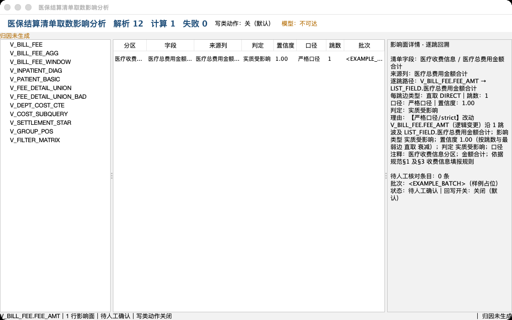
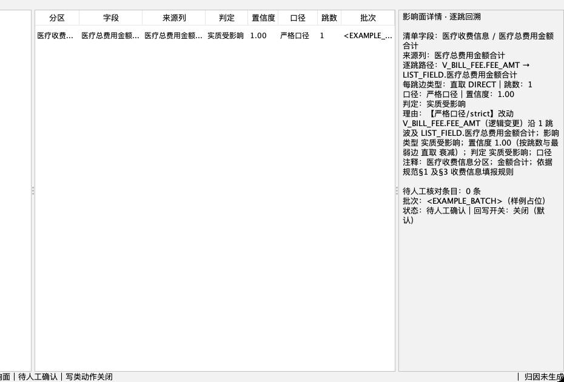
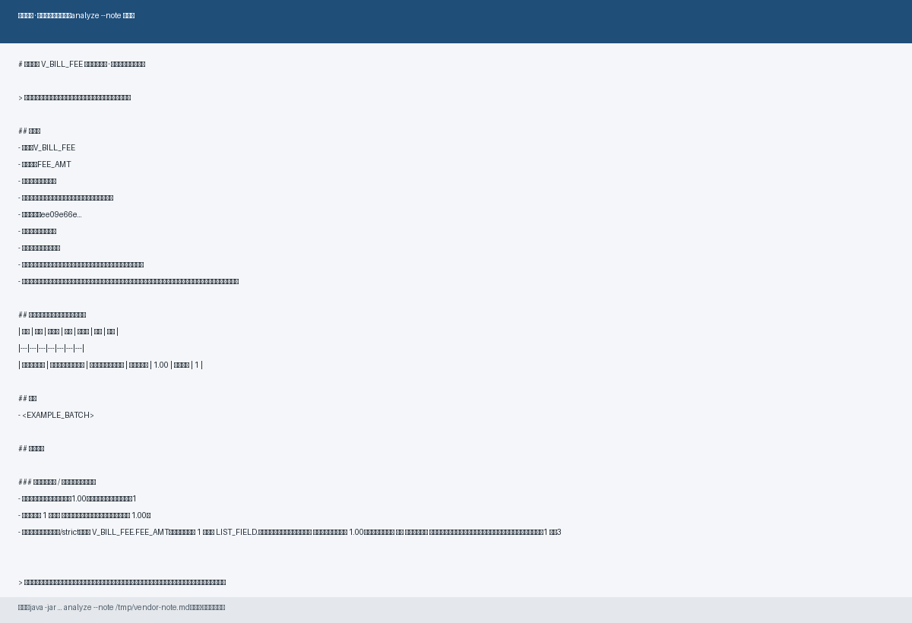

# 医保结算清单取数影响分析

> 医保办数据专员把本院取数视图 SQL 与结算清单字段字典接进桌面工具，当场算出「改这一列会波及哪几栏结算清单字段、归属哪个上报批次」，生成一段可粘给厂商的中文说明；逐行人工确认后回写院内接口管理平台，形成一条清算前可查的变更记录。

本工具吃的是**本院取数 SQL 的字段流向**，不是医保目录价目表：它回答「我改了这一列，谁会跟着变」，而不是「这个项目该报多少钱」。

**正常用法**：双击单 jar 打开三栏工作台，从左侧选视图看影响面，右侧看逐跳依据，工具常驻托盘定时比对视图摘要。命令行只作为运维与排障通道。

---

## 适用场景 / 目标岗位

| 岗位 | 什么时候用 | 得到什么 |
|------|------------|----------|
| 医保办数据专员 | 结算清单改版后、每月清算前核对字段口径 | 一张受影响清单：改这一列会波及哪几栏结算清单字段、属于哪个上报批次，以及每条的影响理由 |
| 信息科接口工程师 | 取数视图改版当天、厂商催着确认口径 | 从改动点到受影响字段的逐跳来源链，改完即留痕，不用靠记忆和口头约定 |
| 医保办主管 / 内审 | 清算材料准备、抽查上次动过什么、波及了哪几栏 | 按批次可回查的变更记录：谁改的、改哪列、波及哪几栏、用的是哪一套口径、谁确认的 |
| 厂商工程师 | 收到说明，要自己核对凭什么说这一栏受影响 | 带路径与跳数的中文说明，逐条可核对到原始取数列 |

## 能力要点

- **改一列，当场看清波及哪几栏**：接进本院取数视图 SQL，沿下游逐跳追出受影响的结算清单字段，并区分实质受影响与疑似波及。
- **两套口径分开给**：改筛选条件会改口径但不改取值，严格口径与保守口径并列呈现，多出来的部分单列，不混在一张表里。
- **说不清的不猜**：星号取列、分支列数不一致、无法安全归并的写法，一律登记为待人工核对并指出具体位置，不静默跳过也不硬凑答案。
- **生成一段能直接粘给厂商的中文说明**：改动点、受影响字段、逐条理由、所用口径一次成型，对方不用看代码就能看懂。
- **逐行人工确认后才回写台账**：未确认时回写入口置灰、服务层同样拒绝；重复提交按幂等键只落一条。
- **常驻托盘盯着视图有没有变**：定时比对取数视图的摘要，变了就重算并气泡提醒，专员不必记得每月点一遍。

## 快速开始

### 依赖

| 项 | 要求 | 说明 |
|----|------|------|
| JRE / JDK | **17 及以上** | 桌面窗口与打包产物均按 Java 17 编译 |
| Maven | 3.9 及以上 | 仅构建期需要；现场只跑单 jar |
| 数据库 | 院内 HIS/EMR **只读**库（Oracle 方言为首版） | 取数视图定义与结算模块字段字典的权威来源 |
| 模型端点 | OpenAI-compatible 端点（院内自建或第三方） | 可选：不可达时降级为仅列名匹配，但**禁止回写** |

### 安装

```bash
cd med-insurance-settlement-impact
mvn -B clean package          # 编译 + 全量测试 + 打单 jar
ls -lh target/med-insurance-settlement-impact.jar
```

打开界面（有显示环境时）：

```bash
java -jar target/med-insurance-settlement-impact.jar
```

窗口出现后，工具自动载入 `src/main/resources/samples/` 下的 12 段脱敏样例视图与 193 项清单字段字典，并跑一次影响面分析；顶栏显示解析 / 计算 / 失败三个数，中央是受影响清单，右侧是逐跳证据链。无显示环境时自动进入 headless 模式，不创建窗口，全部子命令仍可用。

### 配置

凭据与端点**只从环境变量读**，不读配置文件、不接受命令行明文参数、不写盘。

```bash
cp .env.example .env
set -a && . ./.env && set +a
java -jar target/med-insurance-settlement-impact.jar doctor
```

模板共 9 项变量，见下方关键配置项表。**缺任何一项都会显式报错并指出缺哪个变量名，错误信息里不含变量值。**

### 构建与验证

```bash
mvn -B clean test              # 全量回归，实测 264 tests / 0 failures / 0 errors
mvn -B -DskipTests package     # 产出 target/med-insurance-settlement-impact.jar
java -jar target/med-insurance-settlement-impact.jar doctor        # 缺凭据时退出码 1，符合预期
java -jar target/med-insurance-settlement-impact.jar parse-view \
  --sql src/main/resources/samples/views/v_bill_fee.sql --out /tmp/edges.json
```

### 主命令速查

| 子命令 | 用途 |
|--------|------|
| 无参数 | 打开三栏工作台 + 托盘常驻（headless 时打印用法） |
| `doctor` | 环境变量、运行时、驱动自检，只报变量名不回显取值 |
| `version` | 打印版本号 |
| `parse-view` | 视图 SQL → 列级边 JSON |
| `analyze` | 九步主流程 → 影响面 CSV + 厂商说明草稿 |
| `export` | 导出待人工核对清单或变更单 |
| `diff` | 两版取数视图的影响面差异回放 |
| `--help` | 总帮助；各子命令也支持 `--help` |

完整参数与示例见 `docs/cli.md`，输出样例见 `docs/examples.md`，状态机与图算法说明见 `docs/architecture.md`。

## 命令 / API / 配置说明

### 关键配置项

| 配置项 | 默认值 | 说明 |
|--------|--------|------|
| `HIS_DB_URL` | 无（必填） | 院内 HIS/EMR 只读库连接串；首版为 Oracle 方言 |
| `HIS_DB_USER` | 无（必填） | 只读账号；该账号只能读视图定义与字段字典 |
| `HIS_DB_PASSWORD` | 无（必填） | 口令；不进连接串字面量、不写日志 |
| `IFACE_REGISTRY_BASE_URL` | 无（必填） | 院内接口管理平台基址 |
| `IFACE_REGISTRY_TOKEN` | 无（必填） | 台账 Bearer 令牌；只从环境变量读 |
| `MODEL_BASE_URL` | 无（必填） | 模型端点基址，调用 `POST {base}/v1/chat/completions` |
| `MODEL_API_KEY` | 无（必填） | 模型端点凭据；不进日志 |
| `MODEL_NAME` | 无（必填） | 模型名 |
| `MODEL_TIMEOUT_SECONDS` | `30` | 模型读超时秒数；未设置时使用默认值，并在自检里**显式标出**将使用默认值 |

### CLI 子命令 / 接口端点

| 命令或路径 | 用途 | 关键参数 |
|------------|------|----------|
| `doctor` | 环境变量与运行时自检 | 无 |
| `version` | 打印版本号 | 无 |
| `parse-view` | 一段视图 SQL → 列级边 JSON | `--sql <文件>` `--out <JSON>` |
| `analyze` | 读取视图 → 解析 → 构图 → 可达 → 对齐 → 归因 → 待确认 | `--view` `--sql` `--field` `--scope strict\|conservative` `--out <CSV>` `--note <MD>` `--change-kind` `--note-zh` |
| `export` | 待人工核对清单 / 变更单 | `--kind review\|change-order` `--sql` `--out` |
| `diff` | 两版影响面差异回放 | `--old-sql` `--new-sql` `--out <CSV>` |
| `GET {IFACE_REGISTRY_BASE_URL}/api/v1/interface-entries?system=HIS` | 读台账已有变更记录 | Bearer 头 |
| `POST {IFACE_REGISTRY_BASE_URL}/api/v1/interface-entries/{entry_id}/field-change-impacts` | 回写一条变更记录 | Bearer 头 + `Idempotency-Key` 头 |
| `POST {MODEL_BASE_URL}/v1/chat/completions` | 改动语义归因与说明生成 | Bearer 头，OpenAI 兼容格式 |

不指定 `--sql` 时 `analyze` 读取内置脱敏样例视图；不指定 `--out` / `--note` 时只打印摘要。**写类开关默认关闭**，命令行不提供打开真实回写的参数，避免误写院内台账。

### 错误与降级

| 场景 | 表现 | 处理方式 |
|------|------|----------|
| 环境变量缺失 | 启动即报错 | 只列变量名，不列值；按提示补齐后重试 |
| 只读库不可达 | 顶栏红条 | 沿用上次已存的影响面并标注图已过期，**不推算新结论** |
| 清单字段字典读取失败 | 清单字段区为空并报错 | 显式报错，**不按空字典继续算** |
| 取数视图 SQL 解析失败 | 按行列号报告 | 列出待人工核对清单，退出码非 0，不静默跳过 |
| 星号投影 / UNION 分支冲突 | 不可解析标记边 | 登记待人工核对条目，可由 `export --kind review` 导出 |
| MySQL 反引号 / LIMIT 等非 Oracle 语法 | 首版不支持 | 明确报方言不支持并带行列号，不猜测解析 |
| 模型端点不可达 / 超时 / 返回不合规 | 归因未生成 | 降级为仅列名匹配 + 结构化影响表，**禁止回写** |
| 台账回写失败 | 记录置为待回写 | 指数退避重试 ≤2 次；仍失败则托盘提示 + 导出变更单文件 |
| 一对多字段映射歧义 | 标记 AMBIGUOUS | 挂起待人工裁决，**拒绝自动合并** |
| 人工未逐行确认 / 无登记权限 / 写类开关未开 | 回写入口置灰 | 服务层同样拒绝构造回写请求 |

### 对接现有系统

三条出站链路，凭据一律来自上表环境变量，**本地协议替身只用于测试数据层，不是最终对接方式**：

| 对端系统 | 方向 | 协议 | 凭据位 | 降级出口 |
|----------|------|------|--------|----------|
| 院内 HIS/EMR 只读库 | 读 | JDBC（Oracle 首版）：取数视图定义、结算模块字段字典 | `HIS_DB_URL` / `HIS_DB_USER` / `HIS_DB_PASSWORD` | 无，库不可达时不出结论 |
| 院内接口管理平台 | 读 + 写 | HTTP GET / POST + Bearer + `Idempotency-Key` | `IFACE_REGISTRY_BASE_URL` / `IFACE_REGISTRY_TOKEN` | 导出带版本号的变更单 JSON，由专员手工录入台账 |
| 模型端点 | 出站调用 | HTTP `POST /v1/chat/completions`，OpenAI 兼容 | `MODEL_BASE_URL` / `MODEL_API_KEY` / `MODEL_NAME` | 降级为仅列名匹配，界面标注归因未生成并禁止回写 |

**本轮实连边界**：院内只读库、院内接口管理平台、模型端点三条链路均未实连，只实现正式协议客户端并做协议兼容测试；`doctor` 仅能验证变量是否已设，不能验证连通性。

## 典型场景

### 场景 1：医保办数据专员 · 清算前复核口径

打开窗口选中 `V_BILL_FEE`，把改动列登记为 `FEE_AMT`，当场看到受影响的清单字段与逐跳依据；逐行确认后再由人工推进回写。等价的排障命令：

```bash
java -jar target/med-insurance-settlement-impact.jar analyze \
  --view V_BILL_FEE --sql src/main/resources/samples/views/v_bill_fee.sql \
  --field FEE_AMT --out /tmp/impact.csv --note /tmp/vendor-note.md
# 预期：打印 9 步主流程与 1 行影响面，产出 CSV 与中文说明草稿（状态待人工确认）
```

### 场景 2：信息科接口工程师 · 视图改版当天确认波及面

先把新视图解析成可核对的列级边，再与上一版做差异回放：

```bash
java -jar target/med-insurance-settlement-impact.jar parse-view \
  --sql src/main/resources/samples/views/v_bill_fee_agg.sql --out /tmp/agg-edges.json
java -jar target/med-insurance-settlement-impact.jar diff \
  --old-sql src/main/resources/samples/views/v_bill_fee.sql \
  --new-sql src/main/resources/samples/views/v_bill_fee_agg.sql --out /tmp/diff.csv
# 预期：edges JSON 含 SUM/COUNT 聚合边；diff.csv 列出新增 / 消失 / 判定变化 / 口径变化 / 来源变化
```

### 场景 3：医保办主管 / 内审 · 抽查说不清的段落

星号投影不会猜测展开，导出待人工核对清单后由专员逐条裁决：

```bash
java -jar target/med-insurance-settlement-impact.jar export --kind review \
  --sql src/main/resources/samples/views/v_settlement_star.sql --out /tmp/review.json
java -jar target/med-insurance-settlement-impact.jar doctor
# 预期：review.json 含 reason=select_star 的条目与行列号；doctor 逐项报变量是否已设
```

---

## 输出样例

以下片段均为脱敏样例的真实运行产物，批次一律用 `<EXAMPLE_BATCH>` 占位；完整回显、导出文件片段与截图说明见 `docs/examples.md`。

### 影响面 CSV（真实导出片段）

`analyze --out` 产出 UTF-8 带 BOM 的 CSV，列为 分区 / 字段 / 来源列 / 影响类型 / 置信度 / 口径 / 跳数 / 批次 / 判定 / 理由，Excel 双击不乱码：

```csv
分区,字段,来源列,影响类型,置信度,口径,跳数,批次,判定,理由
医疗收费信息,医疗总费用金额合计,医疗总费用金额合计,direct,1.00,strict,1,<EXAMPLE_BATCH>,实质受影响,【严格口径/strict】改动 V_BILL_FEE.FEE_AMT 沿 1 跳波及该栏
```

### 终端输出与厂商说明

```text
$ java -jar ... parse-view --sql .../v_bill_fee.sql --out /tmp/edges.json
视图：V_BILL_FEE，方言：Oracle
SQL 摘要：ee09e66e243d75f8133974ffd455a721df0f80047e214bc8bf756953845a9070
列级边：8 条（直取 4 / 派生 0 / 聚合 0 / 过滤 4）
待人工核对：0 条
```

`analyze --note` 产出的中文说明含改动点、受影响清单字段表（分区 / 字段 / 来源列 / 判定 / 置信度 / 口径 / 跳数）、`<EXAMPLE_BATCH>` 批次占位与逐条理由，全文标为草稿（未人工确认）。`parse-view` 的列级边 JSON 含 `view_name`、64 位 `sql_digest`、`edges[]`、`review_items[]` 与 `report`。这两份完整片段见 `docs/examples.md`。

## 概念 / 实测对照

### 视觉目标

`docs/concepts/visual-target.md` 是一张结构化视觉目标卡：起始态 / 首个可用瞬间 / 成形态三个状态，配色为冷灰底 `#F4F6F9` + 深蓝主色 `#1F4E79`，8px 间距栅格，字体族 Microsoft YaHei / PingFang SC，字段名与幂等键用等宽字体渲染。本环境没有图像生成能力，因此**只提供结构化目标卡，没有伪造概念图**。

### 实测证据

三张实测证据都在 `docs/screenshots/`，采集时确实启动了桌面应用并跑了一次 `analyze`：







> **诚实标注**：`docs/concepts/` 是结构化视觉目标，`docs/screenshots/01` 与 `02` 是真实窗口画面，二者**不是同一张图，也不声称完全一致**。目标卡描述信息层级与配色规范，实测截图反映当前实现：三栏比例、表格密度与字体观感仍有打磨空间。`03` 不是界面截图，而是把 `analyze --note` 真实导出的说明文件逐行排版展示，内容未改写。三张画面均不含患者可识别明细、真实批次号与凭据字面量。

## 架构与数据流

```
┌──────── 输入（三条权威来源） ────────┐
│ ① 本院取数视图 SQL（只读库视图定义）      │
│ ② 结算清单字段字典（只读库字段元数据表）   │
│ ③ 人工改动说明（视图 / 改动列 / 改动类型） │
└─────────────────┬───────────────────┘
                  ▼
┌── 确定性层（可复现，不依赖模型）───┐
│ 视图 SQL ─► 列级边（四类归因）          │
│ 列级边   ─► 字段级血缘图（双方向邻接表）  │
│ 血缘图   ─► 拓扑序 / 环检测 / 下游可达集  │
│ 可达集   ─► 与清单字典对齐（精确→别名→模型）│
└─────────────────┬───────────────────┘
                  ▼
┌── 模型层（唯一增量）────────────────┐
│ 判定是否同义 + 给出理由 + 生成中文说明     │
│ 不可达 → 仅列名匹配，标注归因未生成，禁回写 │
└─────────────────┬───────────────────┘
                  ▼
  人工闸门：逐行确认 → CONFIRMED（只能由人推进）→ 幂等回写台账
                  ▼
┌── 产物（可带走、可回查）────────────┐
│ ① 受影响清单 ② 厂商说明 ③ 影响面 CSV      │
│ ④ 台账变更记录（按批次回查）⑤ 不可变审计链 │
└─────────────────────────────────────┘
```

### 关键不变量

- **幂等键**：`sha256(视图名|视图摘要|改动列)` 同时作台账覆盖键与 HTTP `Idempotency-Key` 头，同一个改动重复提交只落一条记录。
- **确认闸门**：`CONFIRMED` 与 `WRITTEN_BACK` 只能由人工确认动作推进；模型输出、后台任务、接口回写都无权推进（服务层与界面各拦一道）。
- **失败不静默改数据**：解析失败按行列号报告并进待核对清单；库不可达不出新结论；模型降级时禁止回写。
- **口径随记录落库**：每条影响记录都带严格 / 保守口径标签，事后能判断当初用的是哪一套。
- **凭据不进日志**：口令、令牌、API Key 只从环境变量读，日志与异常出栈前统一过脱敏器。
- **状态跨重启留存**：确认与回写状态存在本地单文件库里，重启后仍在，清算前抽查查得到。

## 安全与合规边界

- 本工具**只读取数视图定义与结算清单字段字典，不落任何患者可识别明细**，产物中只有字段级关系。
- 模型只做**改动语义归因与说明草稿**，不产出诊断、治疗或收费结论，也不推进任何业务状态。
- 台账回写**必须经过人工逐行确认**；无接口变更登记权限或未开启写类开关时一律只出草稿与变更单。
- 结算清单字段的口径以**目标统筹区执行的版本**为准；分区项数与内置基准 31 / 6 / 58 / 98 = 193 不一致时会停下并报出差异。清单主诊断与病案首页主诊断口径不同，本工具不用首页口径校验清单主诊断。
- 样例数据全部脱敏，底层表由 TPC-H 形态生成脚本产出；上报批次一律使用 `<EXAMPLE_BATCH>` 占位，不编造具体批次号。

---

## 验收与自检

| 验收项 | 命令 | 期望结果 |
|--------|------|----------|
| 工程可打包 | `mvn -B -DskipTests package` | 产出 `target/med-insurance-settlement-impact.jar` |
| 全量回归 | `mvn -B clean test` | `Tests run: 264, Failures: 0, Errors: 0` |
| 环境自检 | `java -jar target/med-insurance-settlement-impact.jar doctor` | 逐项列出 9 个变量是否已设；缺项时退出码 1 且不出现变量值 |
| 无显示环境降级 | `java -Djava.awt.headless=true -jar target/med-insurance-settlement-impact.jar analyze --help` | 退出码 0，打印参数说明 |
| 取数视图可解析 | `java -jar target/med-insurance-settlement-impact.jar parse-view --sql src/main/resources/samples/views/v_bill_fee.sql --out /tmp/edges.json` | 退出码 0，`edges` 8 条，`sql_digest` 为 64 位十六进制 |
| 主流程可复现 | `java -jar target/med-insurance-settlement-impact.jar analyze --view V_BILL_FEE --sql src/main/resources/samples/views/v_bill_fee.sql --field FEE_AMT --out /tmp/impact.csv --note /tmp/vendor-note.md` | 打印 9 步顺序，产出 CSV 与说明草稿，回写开关关闭 |
| 待核对可导出 | `java -jar target/med-insurance-settlement-impact.jar export --kind review --sql src/main/resources/samples/views/v_settlement_star.sql --out /tmp/review.json` | `review_items` 含 `reason=select_star` 与行列号 |
| README 丰度 | `grep -c '^## ' README.md` / `grep -c '^### ' README.md` / `grep -c '^\|' README.md` / `wc -m README.md` | 依次 ≥10 / ≥8 / ≥5 行表格 / ≥5000 字符 |
| 实测截图 | `ls docs/screenshots/*.png` | 3 张 PNG 且均被本文件引用 |
| 关注区块完整 | `grep -q '## 关注我们' README.md && grep -q 'qrcode.jpg' README.md` | 两条命令均返回 0 |

## 项目结构

```
med-insurance-settlement-impact/
├── pom.xml                                  # Java 17；Druid / sqlite-jdbc / Jackson / 现代 Swing 外观库 / JUnit5；shade 单 jar
├── README.md                                # 本文件：面向医院岗位的产品说明（中文）
├── .env.example                             # 9 项环境变量模板，只含占位说明，无真实值
├── .gitignore                               # 排除 .env / target / data / logs / 缓存；保留 qrcode.jpg 与 screenshots
├── qrcode.jpg                               # 关注公众号二维码
├── docs/
│   ├── concepts/visual-target.md            # 结构化视觉目标卡（无图像生成能力，不伪造概念图）
│   ├── screenshots/                         # 01 工作台 / 02 影响面与详情 / 03 厂商说明导出片段
│   ├── cli.md                               # 全部子命令与参数参考
│   ├── examples.md                          # 真实终端回显与导出产物片段
│   ├── architecture.md                      # 状态机、图算法、审计链说明
│   ├── lineage-baseline-benchmark.md       # 与无向连通分量基线的可复现对比统计
│   └── ui-design-tokens.md                  # 设计 token 与控件四态
├── scripts/
│   ├── fetch-tpch.sh                        # 生成 8 张 TPC-H 形态底层表（可重跑、断网降级）
│   └── gen-samples.sh                       # 样例数据编排：参数未变复用、变更才重建
├── data/                                    # 运行时数据目录（已忽略，不进版本库）
├── logs/                                    # 运行日志与失败事件落盘目录（已忽略）
└── src/
    ├── main/java/com/chaosforge/medins/
    │   ├── App.java                         # 入口：桌面窗口 + 托盘；doctor / parse-view / analyze / export / diff
    │   ├── config/                          # 凭据只从环境变量读，缺失显式报错，日志脱敏
    │   ├── model/                            # 字段键、四类边、清单字段、改动类型、影响记录、状态枚举
    │   ├── sqlparse/                         # 核心：Oracle 视图 SQL → 四类列级边 + 待人工核对清单
    │   ├── lineage/                         # 核心：双方向邻接表、拓扑序、下游可达双口径、解释链
    │   ├── catalog/                         # 结算清单字段字典、四分区校验、字段与列三级对齐
    │   ├── attribution/                      # 单一 ModelGateway、严格 JSON 契约、六类错误与降级
    │   ├── adapter/                         # JDBC 只读、台账 GET/POST、幂等回写、权限闸门
    │   ├── service/                         # 九步主流程、状态机、定时重算与运行统计
    │   ├── store/                           # SQLite 状态、不可变审计链、失败事件落盘
    │   ├── report/                           # 厂商说明、影响面 CSV、两版差异回放
    │   └── ui/                              # 设计 token、三栏工作台、详情抽屉、托盘、三态与响应式
    ├── main/resources/samples/              # 12 段脱敏视图 SQL + 193 项清单字段字典 CSV
    └── test/                                # 264 个 JUnit5 用例：golden 回归、边界降级、协议兼容、UI headless
```

---

## License

MIT

---

## 关注我们

欢迎扫码关注公众号，获取项目更新与交流加群：

